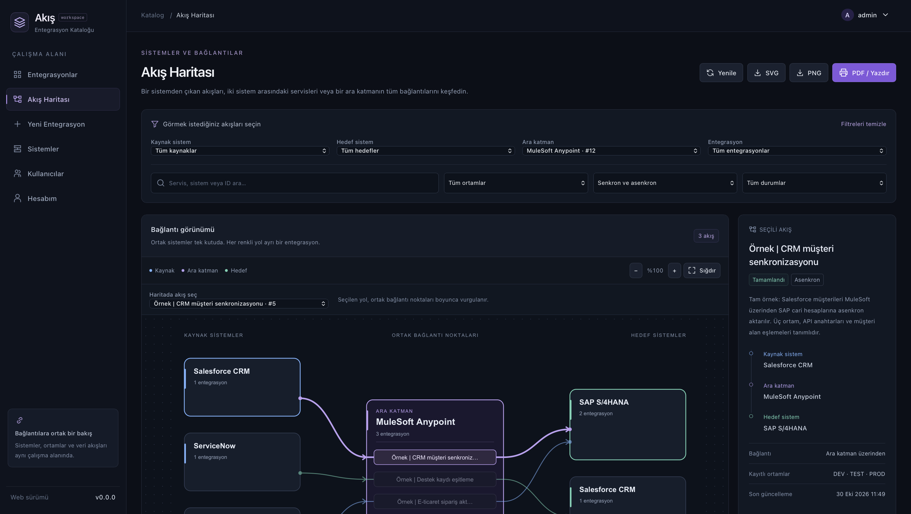
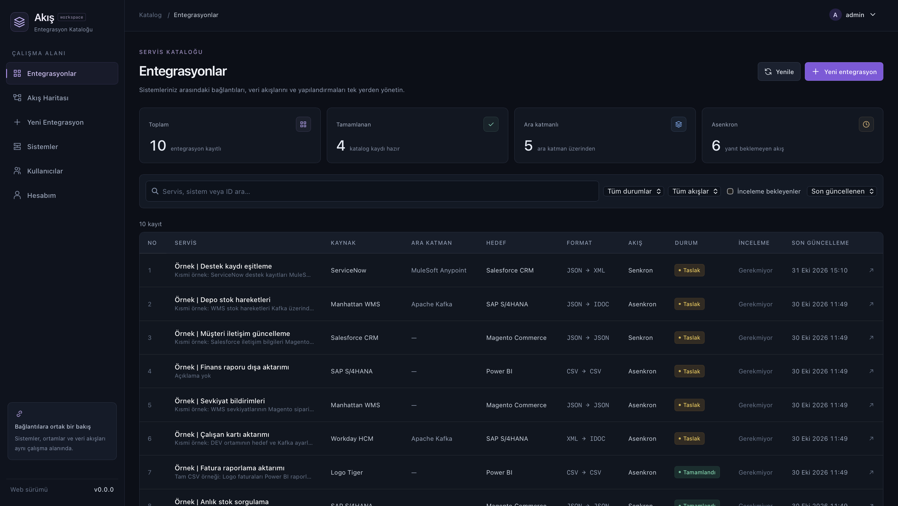
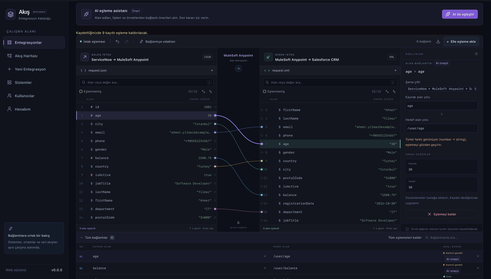
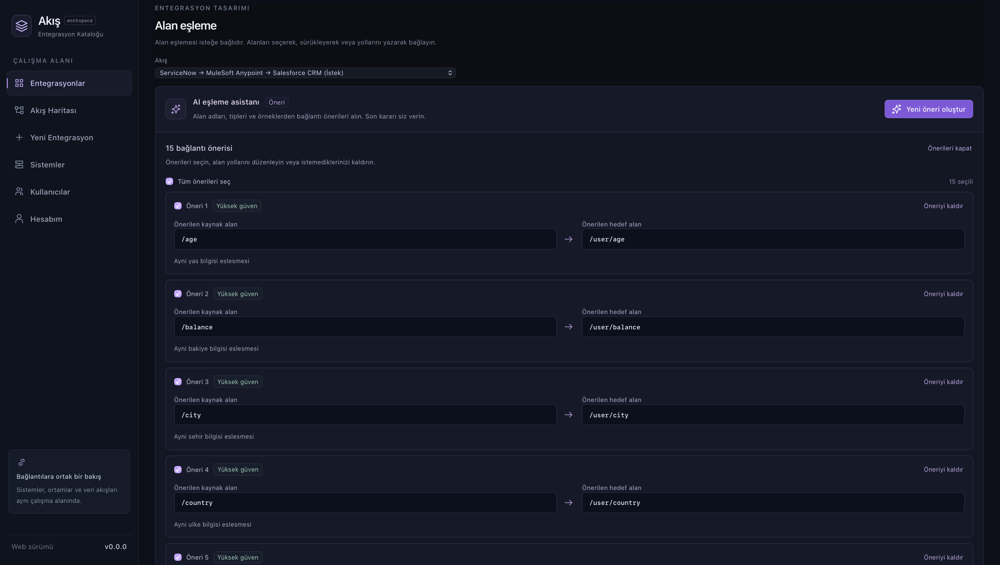

# Integration Catalog Frontend

A web workspace for documenting system integrations, exploring system connections, and mapping payload fields.

This is the frontend for [Integration Catalog](https://github.com/EnginKisin/integration-catalog), an integration-focused Enterprise Architecture Portal. The interface is branded **Akış** and is currently in **Turkish**; developer documentation is in English.

**Stack:** React 19 · TypeScript · Vite · Tailwind CSS · Playwright



*System connections at a glance: explore shared middleware and highlight an integration's path.*

## What you can do

- **Manage an integration catalog:** define source and target systems, optional middleware, synchronous or asynchronous flows, and payload formats.
- **Work through integration setup:** create a draft, configure environments, save request/response samples, map fields, and review the record before completion.
- **Explore a flow map:** filter by source, target, middleware, integration, environment, or status. Shared systems appear as common nodes, and selecting an integration highlights its path. Export the filtered diagram as SVG, PNG, or a printable PDF.
- **Map payload fields:** inspect JSON, XML, and IDOC field trees, create mappings manually, or review AI suggestions before accepting them. CSV and Excel are supported as samples.
- **Manage access:** use session-based sign-in, role-aware screens, user invitations, account recovery, and separate permissions for integration credentials.
- **Read localized errors:** API error codes and structured field violations become Turkish messages, with a request ID for support.

The portal documents integrations. Data transport, integration execution, and live traffic monitoring are outside its scope. Authentication, persistence, authorization, file processing, and AI providers are handled by the backend.

See the [feature guide](docs/FEATURES.md) for workflow details and current limits.

## Screenshots

### Integration catalog

Search and filter integrations, inspect their systems and formats, and track draft and completed records.



### Visual field mapping

Connect source and target fields, inspect example values, and review the selected mapping's properties.



### Review AI suggestions before accepting

Inspect confidence labels and explanations, edit field paths, and select the proposals to keep.



## Getting started

### Prerequisites

- **Node.js 24** and npm. This is the version used for local verification.
- A running, compatible [Integration Catalog backend](https://github.com/EnginKisin/integration-catalog#readme).
- A backend account. Initial administrator setup and invitations are managed by the backend.

### 1. Install dependencies

```sh
git clone https://github.com/EnginKisin/integration-catalog-frontend.git
cd integration-catalog-frontend
npm ci
```

### 2. Configure the development proxy

```sh
cp .env.example .env.local
```

The default configuration is:

```dotenv
VITE_API_PROXY_TARGET=http://localhost:8080
```

Change this value if your backend runs elsewhere. It configures Vite's development proxy. Database, SMTP, bootstrap account, encryption, and AI provider secrets belong in the backend configuration.

### 3. Start the frontend

```sh
npm run dev
```

Open **http://localhost:5173** and sign in with your backend account. Browser API requests use `/api/v1` on the frontend origin; Vite forwards `/api` to the configured backend. Port `5173` is fixed so account-action links can use a predictable address.

For invitation, password-reset, and email-confirmation links, configure the backend with:

```dotenv
ACCOUNT_ACTION_URL=http://localhost:5173/account/action
```

Use `localhost` consistently for this setup. Backend startup, email delivery, and initial administrator configuration are described in the [backend documentation](https://github.com/EnginKisin/integration-catalog/tree/main/docs).

## Development commands

| Command | Purpose |
| --- | --- |
| `npm run dev` | Start the Vite development server on port 5173 |
| `npm test` | Run unit and API-contract tests with mocked responses |
| `npm run test:e2e` | Run Playwright browser tests |
| `npm run lint` | Run ESLint |
| `npm run build` | Type-check the app and create `dist/` |
| `npm run preview` | Preview the production build locally |

Install the browser required by Playwright before the first browser test run:

```sh
npx playwright install chromium --only-shell
npm run test:e2e
```

Browser tests start their own Vite server on `127.0.0.1:4174` and intercept API requests. They run without a live backend. Live backend integration, email delivery, and AI provider quality need separate verification.

## Production deployment

```sh
npm ci
npm run build
```

Serve `dist/` from a static web server and route `/api` to the backend on the **same public origin**. Configure SPA fallback to `index.html` for application routes, including `/login`, `/forgot-password`, and `/account/action`.

The development proxy setting does not configure production routing or `npm run preview`. HTTPS and secure session-cookie configuration must be coordinated with the backend. See the [deployment notes](docs/DEVELOPMENT.md#production-deployment).

## Documentation

| Topic | Guide |
| --- | --- |
| Screens, workflows, permissions, and limits | [Features](docs/FEATURES.md) |
| Architecture, configuration, testing, and troubleshooting | [Development](docs/DEVELOPMENT.md) |
| Reporting issues and proposing changes | [Contributing](CONTRIBUTING.md) |
| Frontend/backend session and workflow contract | [Backend integration guide](https://github.com/EnginKisin/integration-catalog/blob/main/docs/frontend-integration.md) |
| Error envelope, codes, and validation | [Backend error contract](https://github.com/EnginKisin/integration-catalog/blob/main/docs/error-codes.md) |
| AI jobs and field-mapping API | [Backend AI mapping guide](https://github.com/EnginKisin/integration-catalog/blob/main/docs/ai-mapping.md) |

## Project status

This frontend is under active development for the backend's MVP/pilot workflows. Automated tests cover mocked API behavior and browser interactions; they do not establish production readiness. There is currently one user-interface language, Turkish, and no language switcher.

## License

This frontend is licensed under the [MIT License](LICENSE).

Copyright (c) 2026 Engin Kisin. Third-party dependencies retain their respective licenses.
