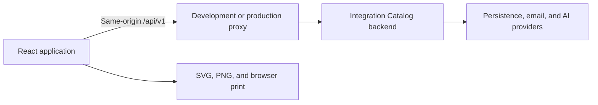

# Development guide

This guide describes the frontend checkout. The [backend repository](https://github.com/EnginKisin/integration-catalog) owns the API implementation, database, email setup, and AI provider configuration.

## Application structure

```text
src/
  auth/                    Session state and account-session lifecycle
  components/
    account/               Sign-in, recovery, profile, and user management
    dashboard/             Catalog, integration setup, mapping, and flow map
    layout/                Application shell and navigation
    ui/                    Shared controls, form feedback, and page structure
  hooks/                   Resource loading and explicit user-triggered tasks
  lib/                     Workflow rules, payload helpers, mappings, and localization
  services/                Same-origin HTTP client and backend adapters
  types/                   Frontend models and API-facing types
tests/
  e2e/                     Playwright tests with intercepted API requests
  fixtures/                Example payloads and the pinned error-contract snapshot
```

The application uses React state for catalog screens and integration selection. Public account routes use the browser history API. Backend DTOs are adapted to frontend models in `src/services/`.



## Local configuration

Use Node.js 24 and the committed npm lockfile:

```sh
npm ci
cp .env.example .env.local
npm run dev
```

| Setting | Default | Effect |
| --- | --- | --- |
| `VITE_API_PROXY_TARGET` | `http://localhost:8080` | Vite development proxy target for `/api` |
| Development frontend port | `5173` | Fixed with `strictPort: true` in `vite.config.ts` |
| Playwright test server | `127.0.0.1:4174` | Separate local server for browser tests |

Restart Vite after changing `.env.local`. `VITE_` variables are not a place for secrets. The frontend does not configure database credentials, SMTP, the initial administrator, encryption keys, or provider API keys.

For local email links, set the backend's `ACCOUNT_ACTION_URL` to `http://localhost:5173/account/action`. Keep the hostname consistent between the frontend, session flow, and account links.

## Backend compatibility

The backend is maintained separately:

- [Frontend integration contract](https://github.com/EnginKisin/integration-catalog/blob/main/docs/frontend-integration.md)
- [Endpoint reference](https://github.com/EnginKisin/integration-catalog/blob/main/docs/api-reference.md)
- [Integration lifecycle](https://github.com/EnginKisin/integration-catalog/blob/main/docs/integration-workflow.md)
- [Payload and file rules](https://github.com/EnginKisin/integration-catalog/blob/main/docs/payload-content.md)
- [AI field-mapping contract](https://github.com/EnginKisin/integration-catalog/blob/main/docs/ai-mapping.md)
- [Shared error contract](https://github.com/EnginKisin/integration-catalog/blob/main/docs/error-codes.md)

The error tests use a committed [catalog snapshot](../tests/fixtures/error-catalog.json) from a documented backend commit. Its source is recorded in the [fixture guide](../tests/fixtures/README.md). The application does not fetch this catalog at runtime, and unit tests do not require a separate backend checkout or network access.

That snapshot establishes the tested error vocabulary, not a compatibility guarantee for every endpoint. When updating the backend contract, review the service adapters, workflow rules, error vocabulary, and test fixtures together.

## Sessions and API requests

`src/services/api.ts` sends requests to `/api/v1` with session cookies. It obtains CSRF metadata from the backend and attaches the supplied token to state-changing requests.

- Sign-in uses form-encoded credentials and refreshes CSRF after authentication.
- Access-denied errors and CSRF errors are handled separately.
- An expired or invalidated session returns the user to the sign-in flow.
- Failed writes are not automatically repeated. An uncertain write is reconciled by reading current state before another change.
- HTTP 429 responses respect `Retry-After`. AI polling uses its separate `pollAfterMs` interval.

Account-action links use a URL fragment. The link token is captured in memory and removed from the address bar before the account form runs. Consuming a link requires an explicit user action.

## Error localization

`src/lib/apiErrors.ts` owns Turkish error text. API behavior depends on stable codes, structured violations, and HTTP status; English backend fallback messages are not parsed to decide behavior.

`ApiError` preserves the error code, safe parameters, violations, request ID, and retry time. The shared error panel lists translated requirements and displays the support request ID. `FormField` also attaches matching violations to supported form controls through `aria-invalid` and `aria-describedby`. Editing a field dismisses its old server feedback.

Unknown error codes use a generic Turkish message. Code-bearing AI diagnostics are localized too. Free-form model explanations and warnings without codes retain their original content; there is no automatic translation service.

## Testing

```sh
npm test
npm run build
```

Unit tests use Node's test runner and TypeScript source imports. API-contract tests replace `fetch` with controlled responses. Keep their fixtures deterministic and avoid dependencies on a live backend.

For browser tests:

```sh
npx playwright install chromium --only-shell
npm run test:e2e
```

Playwright starts the test server declared in `playwright.config.mjs`. Requests are intercepted in the tests; the suite does not write records to a running backend. Traces, screenshots, and reports are local test artifacts and are ignored by Git.

Run lint when changing source code:

```sh
npm run lint
```

Use a real backend for end-to-end acceptance of sign-in, permission changes, email links, credential access, payload parsing, and AI jobs. Mocked tests do not establish provider quality or email delivery.

## Production deployment

Build static assets:

```sh
npm ci
npm run build
```

The generated site is in `dist/`. Configure the deployment so that:

1. The web server serves those static assets.
2. `/api` is forwarded to the compatible backend, preserving the `/api/v1` path.
3. Application routes fall back to `index.html`, including direct visits to `/account/action`.
4. The browser uses one HTTPS origin for the UI and API, with the backend's cookie and proxy settings configured accordingly.

`VITE_API_PROXY_TARGET` is a development-server setting. It does not create a proxy in a static deployment or in `npm run preview`. Configure API routing at the production web server or hosting layer.

## Troubleshooting

| Symptom | Check |
| --- | --- |
| Sign-in or catalog loading cannot reach the server | Confirm that the backend is running and restart Vite after checking the proxy target. |
| Vite refuses to start | Free port 5173 or deliberately update the port and backend account-action URL together. |
| An email link opens the wrong host or port | Check the backend's `ACCOUNT_ACTION_URL` and use a consistent hostname. |
| Refreshing an account route returns a server 404 | Configure the static server's SPA fallback. |
| A write failed after a connection interruption | Read the current record before retrying; the original request may have completed. |
| AI suggestions are unavailable | Review backend capability/configuration information; manual field mapping remains available. |
| A validation error needs investigation | Use the request ID shown in the error panel to correlate with backend logs. |
